

# ☠ DONNY BOY 1.0.5
### DARK SIGNAL · ČESKÝ FIRMWARE · FLIPPER ZERO

Základ aktuálního vydání: **dev@53818b18**. [Strojově čitelná metadata](site/release.json).

**Vlastní sestavení firmwaru pro Flipper Zero s cílem přinést české prostředí a přehlednější používání.**

 

[ **⬇ STÁHNOUT DONNY BOY 1.0.5** ](https://github.com/luciferbelzebob3-afk/DONNYBOYCZ/releases/tag/v1.0.5) ·
[ Zdrojový kód ](https://github.com/luciferbelzebob3-afk/DONNYBOYCZ) ·
[ Nahlásit chybu ](https://github.com/luciferbelzebob3-afk/DONNYBOYCZ/issues) ·
[ Web projektu ](https://luciferbelzebob3-afk.github.io/DONNYBOYCZ/)

---

> `[ SYSTÉM ONLINE ]`  `[ CÍL: FLIPPER ZERO ]`  `[ SESTAVENÍ: DONNY BOY 1.0.5 ]`
>
> **Nejde o oficiální firmware Flipper Devices.** DONNY BOY je komunitní fork založený na projektu Unleashed Firmware. Používej ho zodpovědně a pouze v souladu se zákony.

## Obsah

- [Co je DONNY BOY?](#co-je-donny-boy)
- [Vzhled a animace verze 1.0.5](#vzhled-a-animace-verze-105)
- [Hlavní cíle](#hlavni-cile)
- [Stažení firmwaru](#stazeni-firmwaru)
- [Instalace](#instalace)
- [Český překlad](#cesky-preklad)
- [Funkce a možnosti](#funkce-a-moznosti)
- [Stav projektu a sestavení](#stav-projektu-a-sestaveni)
- [Řešení problémů](#reseni-problemu)
- [Bezpečnost a legální použití](#bezpecnost-a-legalni-pouziti)
- [Vývoj a příspěvky](#vyvoj-a-prispevky)
- [Poděkování a licence](#podekovani-a-licence)

## Co je DONNY BOY?

**DONNY BOY** je vlastní sestavení firmwaru pro zařízení **Flipper Zero**, které vychází z otevřeného projektu [Unleashed Firmware](https://github.com/DarkFlippers/unleashed-firmware). Cílem tohoto forku je připravit firmware s českým prostředím, udržovat vlastní sestavení a postupně zlepšovat srozumitelnost textů zobrazovaných na displeji.

Projekt je určen lidem, kteří si chtějí své zařízení lépe přizpůsobit, zajímají se o elektroniku, vestavěné systémy, bezdrátové technologie a vývoj open-source softwaru.

**DONNY BOY 1.0.5 je aktualizované sestavení projektu.** Kompilace a distribuční soubory byly ověřeny. Fyzický test aktuální verze zatím neproběhl; dřívější test bez pozorovaných chyb se týkal verze 1.0.1. Historická vydání zůstávají dostupná v seznamu vydání.

## Vzhled a animace verze 1.0.5

Nové logo DONNY BOY uvádí českou obrazovku po aktualizaci. Postava v pěti animacích dostala svislé oči a dál mrká v původním rytmu.

| Česká obrazovka po aktualizaci | Detail svislých očí a mrknutí |
| :---: | :---: |
| 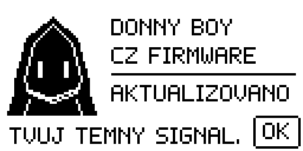 | 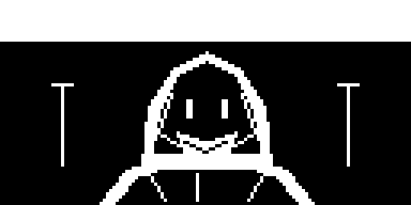 |

### DARK SIGNAL

| Kapuce | Noční vysílač | Radar | DONNY BOY |
| :---: | :---: | :---: | :---: |
| 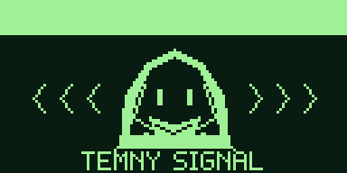 | 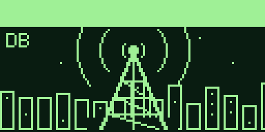 | 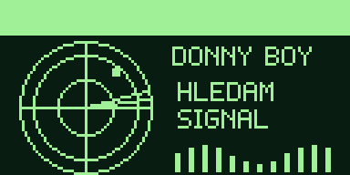 | 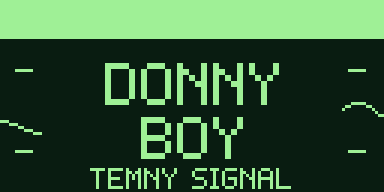 |

### Kluk v kapuci

| Dech a pohled | Matrix | Kluk ve stínu | Prostorová kapuce |
| :---: | :---: | :---: | :---: |
| 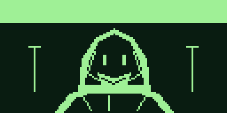 | 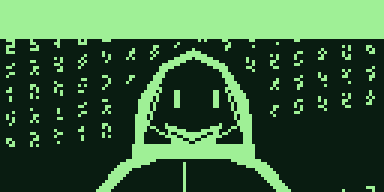 | 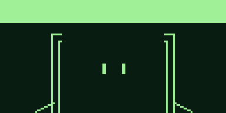 | 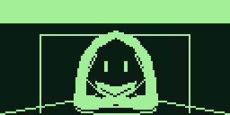 |

### Automobilové scény

| Noční auto | Auto v garáži | Přístrojová deska | Noční jízda |
| :---: | :---: | :---: | :---: |
| 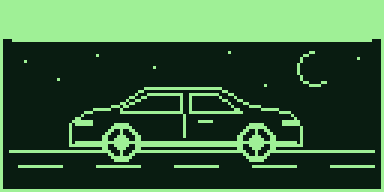 | 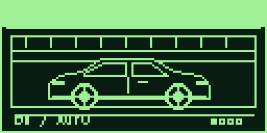 | 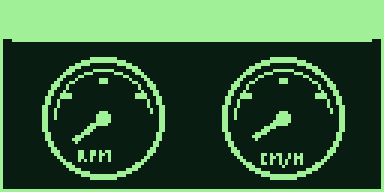 | 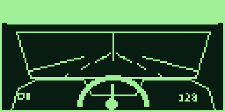 |

GIFy vycházejí ze snímků přímo z vydání 1.0.5. Barvy simulují podsvícení displeje. Pro animace na microSD použij aktualizační balíček `.tgz`.

[Instalace a přehled animací](documentation/DonnyAnimations.md) · [Vydání DONNY BOY 1.0.5](https://github.com/luciferbelzebob3-afk/DONNYBOYCZ/releases/tag/v1.0.5)

## Hlavní cíle

- **Čeština na prvním místě** — postupně překládat uživatelské texty a hlášky do češtiny.
- **Bez diakritiky ve firmwaru** — texty určené pro displej mají být psané bez háčků a čárek, aby odpovídaly požadavku projektu a možnostem zobrazení.
- **Funkční sestavení** — před zveřejněním ověřit, že firmware úspěšně projde automatickou kompilací.
- **Otevřený vývoj** — změny, chyby a další práce jsou dohledatelné ve veřejném repozitáři.
- **Praktická dokumentace** — nabídnout jasný postup stažení, instalace a nahlášení problému.

## Stažení firmwaru

### Nejjednodušší cesta

➡️ **[Otevřít stránku vydání a stáhnout dostupné soubory](https://github.com/luciferbelzebob3-afk/DONNYBOYCZ/releases/tag/v1.0.5)**

V části **Soubory ke stažení** vyber soubor firmwaru nebo balíček sestavení. Pokud chceš pouze zdrojové kódy, použij tlačítko **Code → Download ZIP** nebo si repozitář naklonuj.

**Důležité:** artefakt z GitHub Actions je balíček sestavení; nemusí to být samostatný instalační program pro každou metodu aktualizace. Před instalací si přečti pokyny níže a ověř, že vybraný soubor odpovídá tvému zařízení.

## Aktualizace DONNY BOY 1.0.5

**Základ: Unleashed dev z 16. 11. 2026 (`53818b18`), API 88.27.** Vydání navazuje na vývojovou větev upstreamu.

### Nové protokoly Sub-GHz

| Protokol | Formát | Co přibylo |
|---|---|---|
| BelKorn | 118 bitů, plovoucí kód | Korn / BelGate / Furniteh, vlastní tlačítka, ruční přidání |
| FAAC TM | 12 bitů | Čtení, ukládání, vysílání a zadání TE |
| Freezer | 24 bitů | Nový dekodér a enkodér |
| Proteco | 24 bitů | Nový dekodér a enkodér |

### Změny ovládání, aplikací a vzhledu

- Přepracované Přidat ručně: jedna položka pro systém, frekvence a modulace v dalším kroku, obvyklá pásma systému na začátku seznamu. Pokročilé zadání TE pro Princeton, ZKTeco a FAAC TM; guard time pro Princeton a ZKTeco; discriminator Ds pro DEA Mio.
- Čtení Sub-GHz zobrazuje konkrétní rozpoznaný systém u CAME, Nice FloR-S, FAAC SLH a KeeLoq. Opravená signalizace při zaplnění seznamu a mazání starých signálů; oprava interního rádia v CLI.
- Nová aplikace Analyzátor ovladačů: čtení posledního signálu, analýza frekvence, dekódování uloženého RAW, hledání modulace a přelaďování. Navíc podporuje Crypt, Crypt Lite, Hormann BiSecur, KCE6xxx, Life Fido, Nero Intro II a PC4. BelGate je nově součástí hlavního protokolu BelKorn.
- Nová aplikace T5577: čtení a ukládání bloků, úprava konfigurace a výpisů, zápis, test zapisovatelných bloků, vymazání a správa hesel. Navazující změny RFID zahrnují přehlednější výsledky zápisu a reorganizaci příslušných scén.
- Oprava rozložení MfUltralightData pro kompatibilitu předkompilovaných NFC aplikací s NTAG/Ultralight; řeší také chybné hlášení hesla ve Weebo. Další převzaté opravy NFC, archivu, iButton, IR, GUI, úložiště a JavaScriptu.
- Obnovené a doplněné české texty bez diakritiky v nových i změněných obrazovkách; kompletní český návod analyzátoru ovladačů. Zachované technické názvy a klíče souborových formátů.
- Kratší hlášky PAMET PLNA a AKTUAL.; dlouhé stavové texty aktualizátoru a T5577 se omezují podle dostupné šířky displeje.
- Nové monochromatické logo DONNY BOY a česká obrazovka po aktualizaci. Při běžném restartu krátké uvítání na 1,2 sekundy; český průvodce prvním spuštěním má přednost.
- Zachovaných 12 animací a 320 snímků. V pěti animacích postavy upravené svislé oči, 192 zpracovaných snímků, původní pohyby i načasování mrknutí; Matrix zůstává s deštěm znaků. Zachované vlastní manifesty a výběr kolekce DONNY BOY.

**Ověření vydání:** kompilace, metadata a instalační balíčky byly ověřené automaticky; fyzický test této verze zatím neproběhl. Historické fyzické ověření se týkalo 1.0.1.

**[Otevřít vydání 1.0.5](https://github.com/luciferbelzebob3-afk/DONNYBOYCZ/releases/tag/v1.0.5)** · [Úplné poznámky k verzi](documentation/Release-1.0.5.md)

## Instalace

1. **Zálohuj důležitá data.** Ulož si vlastní soubory, nastavení a další obsah, který nechceš ztratit.
2. **Zkontroluj model a stav zařízení.** Použij pouze firmware určený pro Flipper Zero.
3. **Stáhni balíček z vydání.** Stahuj pouze z tohoto repozitáře a ověř název souboru.
4. **Použij ověřený postup aktualizace.** Řiď se oficiální dokumentací Flipper Zero a pokyny projektu Unleashed. Nezkoušej náhodné soubory ani postupy určené pro jiné modely.
5. **Po aktualizaci zkontroluj základní funkce.** Ověř start zařízení, navigaci v menu, připojení přes USB a funkce, které běžně používáš.

Užitečné odkazy:
- [Oficiální dokumentace Flipper Zero](https://docs.flipper.net/)
- [Návod k instalaci v projektu Unleashed](https://github.com/DarkFlippers/unleashed-firmware/blob/dev/documentation/HowToInstall.md)
- [Vydání tohoto forku](https://github.com/luciferbelzebob3-afk/DONNYBOYCZ/releases/tag/v1.0.5)

Pokud si nejsi jistý, který soubor vybrat, neinstaluj ho naslepo. Nejprve otevři issue a uveď model zařízení, název souboru a postup, který chceš použít.

## Český překlad

Hlavním dlouhodobým cílem je **české uživatelské rozhraní**. Překlad se zaměřuje na texty, které se skutečně zobrazují na displeji: názvy nabídek, položky nastavení, potvrzovací dialogy, chybové hlášky a texty jednotlivých aplikací.

Při překladu dodržujeme několik pravidel:

- Používat krátké a srozumitelné české výrazy, které se vejdou na malý displej.
- Nepřekládat technické identifikátory, názvy proměnných, protokolů ani interní symboly, pokud se nezobrazují uživateli.
- Zachovat formátovací značky, parametry, zástupné symboly a řídicí sekvence v kódu.
- Nepřidávat diakritiku do textů určených pro firmware, pokud by mohla způsobit problém se zobrazením.
- Po změně textů kontrolovat kompilaci, protože i zdánlivě drobná změna může odhalit chybu v kódu.

Překlad se vyvíjí postupně. **Vydání 1.0.5 neznamená, že je každá obrazovka firmwaru již kompletně přeložená.** Pokud narazíš na anglický text v uživatelském rozhraní, můžeš ho nahlásit v [hlášení problémů](https://github.com/luciferbelzebob3-afk/DONNYBOYCZ/issues) včetně názvu nabídky nebo aplikace.

## Funkce a možnosti

Základ projektu vychází z Unleashed Firmware. Konkrétní dostupnost funkcí závisí na verzi zdrojového kódu a na výsledném sestavení.

### Bezdrátové a hardwarové funkce

- **Sub-GHz** — práce s podporovanými rádiovými protokoly a signály v rámci možností zařízení.
- **Infračervené ovládání** — práce s kompatibilními IR signály a dálkovými ovladači.
- **NFC a RFID** — čtení a práce s podporovanými typy tagů a karet.
- **iButton** — podpora kompatibilních identifikačních zařízení.
- **GPIO a externí hardware** — možnosti experimentování s elektronickými moduly a periferiemi.
- **USB a vývojářské nástroje** — funkce pro testování, ladění a práci se zařízením.
- **Aplikace a pluginy** — dostupnost se řídí obsahem konkrétního buildu.

Ne všechny funkce vyžadují nebo podporují externí příslušenství. Před připojením modulu ověř zapojení, napětí a kompatibilitu.

### Přizpůsobení a každodenní používání

- Nastavení zařízení a některých prvků uživatelského rozhraní.
- Práce se soubory a daty podporovanými firmwarem.
- Používání vestavěných aplikací a kompatibilních doplňků.
- Možnost sledovat změny zdrojového kódu a sestavovat vlastní varianty.

Tento seznam popisuje oblasti funkcí základního projektu, nikoli záruku, že každá jednotlivá funkce byla samostatně otestována v DONNY BOY 1.0.5.

## Stav projektu a sestavení

| Položka | Stav |
|---|---|
| Projekt | DONNY BOY |
| Verze sestavení | 1.0.5 |
| Cílové zařízení | Flipper Zero |
| Větev vývoje | `dev` |
| Fyzický test aktuální verze | Zatím neproveden; starší 1.0.1 byla fyzicky otestována |
| Sestavení 1.0.5 | Úspěšné; vydání je zveřejněné |
| Automatická kompilace a kontroly | Spouštění podle nastavení pracovního postupu |
| Automatické nasazení webu | Povoleno |
| Zdrojový commit sestavení | `d4063a4dbb37526771a088aeef828df08c7e96e9` |
| Stav českého překladu | Průběžně rozpracovaný |
| Distribuce | GitHub Releases |

Historické běhy sestavení verze 1.0.0:
- [Kompilace firmwaru DONNY BOY](https://github.com/luciferbelzebob3-afk/DONNYBOYCZ/actions/workflows/sync-unleashed.yml)
- [Kompilace a analýza](https://github.com/luciferbelzebob3-afk/DONNYBOYCZ/actions/workflows/sync-unleashed.yml)

Tyto odkazy slouží jako záznam dřívějších běhů. Stav současných pracovních postupů a kontrol najdeš na kartě **Actions**.

## Řešení problémů

### Zařízení po aktualizaci nenaběhne
- Zkontroluj, zda byl vybrán správný balíček.
- Postupuj podle oficiální dokumentace k obnovení nebo opětovnému nahrání firmwaru.
- Nepřerušuj aktualizaci a neodpojuj zařízení v průběhu zápisu.

### V menu zůstává angličtina
Překlad není ve verzi 1.0.5 kompletní. Otevři issue a připoj přesný text, název aplikace a cestu v menu, kde se zobrazuje.

### Kompilace selže
1. Otevři kartu **Actions** a vyber neúspěšný běh.
2. Najdi první skutečnou chybu kompilátoru; závěrečné `Error 1` nebo `exit code 2` je obvykle jen souhrn.
3. Zkopíruj chybovou hlášku a uveď označení změny, na které kompilace selhala.
4. Nahlas problém přes [hlášení problémů](https://github.com/luciferbelzebob3-afk/DONNYBOYCZ/issues).

### Něco nefunguje jako dřív
Uveď očekávané chování, skutečný výsledek, kroky k reprodukci a případně fotografie obrazovky. Nezveřejňuj citlivá data ani soubory, které nepatří tobě.

## Bezpečnost a legální použití

Flipper Zero je nástroj pro práci s elektronikou a digitálními systémy. Používej jej pouze na vlastních zařízeních nebo se souhlasem jejich vlastníka a dodržuj místní právní předpisy.

- Nepoužívej zařízení k neoprávněnému přístupu, rušení komunikace ani zásahům do cizích systémů.
- Dodržuj pravidla pro rádiové vysílání a místní omezení frekvencí a výkonu.
- Před experimentem s GPIO si ověř napětí a zapojení; nesprávné připojení může zařízení poškodit.
- Rozšířené nebo experimentální funkce mohou mít vedlejší účinky a mohou být v některých zemích omezené.
- Instalací vlastního firmwaru přebíráš odpovědnost za své použití a případné následky.

DONNY BOY je komunitní projekt. Není oficiálně vyvíjen, schválen ani podporován společností Flipper Devices.

## Vývoj a příspěvky

Chceš pomoct s překladem nebo s opravou chyby? Příspěvky jsou vítané.

1. Projdi existující [issues](https://github.com/luciferbelzebob3-afk/DONNYBOYCZ/issues), aby se stejný problém neřešil vícekrát.
2. Pro překlad uveď původní text, navrhovaný český text a místo, kde se zobrazuje.
3. U změny kódu zachovej formátování, zástupné symboly a technické identifikátory.
4. Ověř, že změna neblokuje kompilaci.
5. Popiš změnu v commitu nebo pull requestu stručně a konkrétně.

Repozitář: [DONNY BOY CZ](https://github.com/luciferbelzebob3-afk/DONNYBOYCZ)

## Poděkování a licence

Poděkování patří vývojářům původního firmwaru Flipper Zero, týmu [DarkFlippers / Unleashed Firmware](https://github.com/DarkFlippers/unleashed-firmware) a všem přispěvatelům do open-source ekosystému Flipper Zero.

Tento fork je nezávislý komunitní projekt. Ochranné známky a názvy příslušných projektů náleží jejich vlastníkům. Licence a licenční podmínky zdrojového kódu jsou uvedeny v souboru [LICENSE](LICENSE).

---

**DONNY BOY 1.0.5 — DARK SIGNAL pro Flipper Zero.**

`ZŮSTAŇ ZVĚDAVÝ · TESTUJ ODPOVĚDNĚ · PODPORUJ OTEVŘENÝ KÓD`

[⬇ Stáhnout vydání](https://github.com/luciferbelzebob3-afk/DONNYBOYCZ/releases/tag/v1.0.5) ·
[Prohlédnout zdrojový kód](https://github.com/luciferbelzebob3-afk/DONNYBOYCZ) ·
[Nahlásit chybu](https://github.com/luciferbelzebob3-afk/DONNYBOYCZ/issues)

