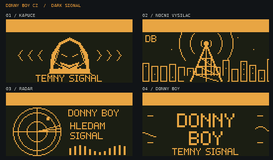
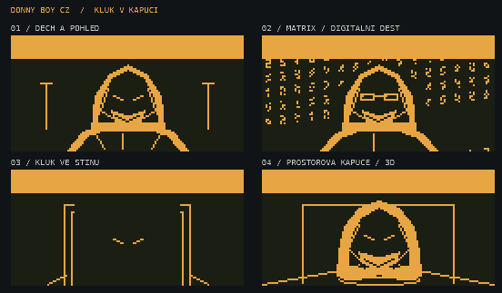

# DONNY BOY CZ 1.0.3a — osm animací

Písmeno **a znamená animace**. Vydání navazuje na 1.0.3 a zachovává jeho motiv
DARK SIGNAL, české rozhraní, menu, zámek a nastavení.

| Název | Složka v `/ext/dolphin` | Snímky / rychlost |
| --- | --- | --- |
| Kapuce | `DB_DS_Kapuce_128x64` | 32 / 8 fps |
| Noční vysílač | `DB_DS_Vysilac_128x64` | 32 / 8 fps |
| Radar | `DB_DS_Radar_128x64` | 32 / 8 fps |
| DONNY BOY | `DB_DS_Logo_128x64` | 32 / 8 fps |
| Dech a pohled | `DB_Kluk_Dech_128x64` | 40 / 10 fps |
| Matrix | `DB_Kluk_Matrix_128x64` | 40 / 10 fps |
| Kluk ve stínu | `DB_Kluk_Stin_128x64` | 40 / 10 fps |
| Prostorová kapuce | `DB_Kluk_3D_128x64` | 40 / 10 fps |

Všech 288 snímků má 128 × 64 pixelů a 1bitové barvy. Horních 13 řádků je
ponechaných stavovému pruhu. Každá smyčka trvá 4 sekundy, vybraná animace se
přehrává 12 sekund. Výběr je náhodný, může vybrat stejnou scénu opakovaně.
Všechny jsou povolené na úrovních 1–3 a v rozsahu nálady 0–14.

Matrix používá padající sloupce pixelových znaků a postavu v kapuci s brýlemi.
Prostorová kapuce má perspektivní otáčení jednoduchého modelu a paralaxu;
zařízení přehrává předem vykreslené bitmapy, nikoli 3D engine.
Starší chůze ani nasazování kapuce nejsou součástí této osmičky.

Barva náhledů pouze napodobuje podsvícení. Skutečný displej je monochromatický.

## Instalace

1. Zálohuj data Flipperu, vlastní `/ext/dolphin` a nastavení plochy.
2. Z vydání 1.0.3a stáhni `flipper-z-f7-update-1.0.3a.tgz`.
3. Použij aktualizaci ze souboru přes qFlipper. Aktualizační balíček obsahuje
   firmware, aktualizátor a SD prostředky se všemi osmi animacemi.
4. Nech dokončit i instalaci SD prostředků. Samotné nahrání DFU animace na SD
   nedoplní. Po restartu se na ploše přednostně vybírají nové animace.

Při použití vlastního manifestu jej zálohuj a případné vlastní záznamy po
aktualizaci sluč s novým manifestem; aktualizátor spravuje systémové prostředky.
Původní vestavěná animace zůstává dostupná bez SD a jako záloha při chybě načtení.
Systémová upozornění a zvýšení úrovně mají nadále přednost před běžnou plochou.
Zamykací obrazovka a PIN se nemění.

Pro návrat použij původní firmware a zálohované prostředky. Při přechodu na
firmware před motivem DARK SIGNAL dodrž i [obnovu nastavení plochy](DarkSignal.md).

## Zdroj a kontrola

Zdrojové PNG a metadata jsou přímo v `assets/dolphin/external`. Standardní
`DolphinExtBuilder` je při sestavení převede do `.bm` a zahrne do SD prostředků.
Výběr plochy již nevrací vždy jednu původní animaci: pokud jsou v manifestu
dostupné nové scény, přednostně losuje mezi nimi. Bez této kolekce funguje
původní mechanismus výběru a záložního načtení.

Build ověřuje všech osm animací přímo v dokončeném `.tgz`: rozbalí
`resources.ths`, zkontroluje manifest, metadata a přítomnost 288 bitmap a každou
dekóduje a porovná se zdrojovým PNG po jednotlivých pixelech. Výsledný report je
součástí souborů vydání jako `animace-overeni.json`.

Kontrola Unleashed dne 2. 11. 2026 potvrdila jako poslední stabilní vydání
`unlshd-094`, již obsažené v 1.0.3. Nebylo potřeba přebírat další stabilní změny
ani překládat nové texty. Novější vývojové commity upstreamu nejsou vydanou
stabilní verzí a do tohoto vydání nebyly převzaty.

Úspěšné sestavení a kontrola souborů nejsou fyzický test zařízení. Nová verze
zatím nebyla fyzicky otestována; historický test 1.0.1 se na ni nevztahuje.
