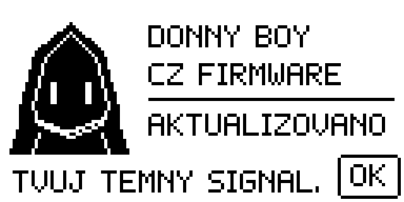
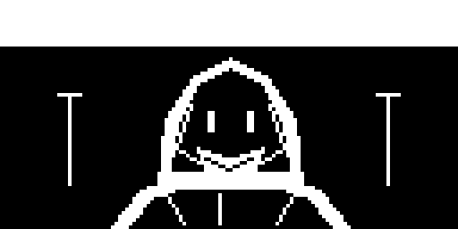

# DONNY BOY CZ – vývojová aktualizace 16. 11. 2026

Zdrojová verze **1.0.5-dev**, Unleashed dev `53818b18f63e105baaf37ed8eac9a7def58ec8b1`, API **88.27**.

- Převzaté změny od zaznamenaného upstreamu `2f62b3ab5d767c41e09ab17c6b5fbd175c8c4c85`, sloučené s vlastními úpravami forku. Projektová automatizace a vlastní manifesty animací zůstaly zachované.
- BelKorn, přepracované ruční přidávání Sub-GHz, výběr frekvence/modulace, TE/GT, opravy seznamu signálů a interního rádia. Nové aplikace Remote Analyzer a T5577 i navazující knihovny.
- Oprava rozložení `MfUltralightData` pro kompatibilitu hotových NFC aplikací.
- Obnovené české překlady a doplněné nové nabídky, dialogy, stavové texty a návod. Displejové texty bez diakritiky; technické názvy, protokolové hodnoty a serializační klíče se nepřekládají. Doplněná překladová paměť.
- Zkrácení hlášení na `PAMET PLNA` a nadpisu na `AKTUAL.`. Šířka textu ověřená podle skutečných fontů. Dlouhé stavy aktualizátoru a T5577 se vejdou do svého sloupce.
- Nové monochromatické logo DONNY BOY s českým textem. Po aktualizaci jedna potvrzovací obrazovka místo čtyř anglických. Při běžném startu logo na 1,2 sekundy; instalovaný úvodní průvodce má přednost. Průvodce je rovněž česky.
- Svislé oči v pěti animacích postavy (192 zpracovaných snímků) s původními pohyby a načasováním mrknutí. Matrix si zachovává déšť znaků. Všech 12 kolekcí (320 snímků) a interní animace zůstávají přítomné.

## Kontroly a omezení

Prošlo 35 existujících Python testů, kontrola metadat a odkazů animací, rozměrů a jednobitového formátu PNG, opakovatelnosti generátoru, šířky zkrácených textů, konfliktů a `git diff --check`. Při integraci odstraněný duplicitní IR test; aktuální upstream už zahrnuje databáze projektorů, ventilátorů a LED.

**Firmware nebyl sestavený, GitHub Actions nebyly spuštěné, release nebyl vydaný a změny nejsou otestované na fyzickém zařízení.** `.donny/completed.json` nadále popisuje skutečně dokončené vydání 1.0.4; stav této zdrojové aktualizace je odděleně v `.donny/dev-update.json`.

Po povolení sestavení je nutné ověřit start s PINem i bez něj, úvodní průvodce, jednu aktualizační obrazovku, chybějící/poškozenou SD kartu, hlášení plné paměti, navigaci ručního přidávání a kompatibilitu NFC FAP aplikací. Změny zdrojů se na zařízení projeví až instalací nového sestavení.

