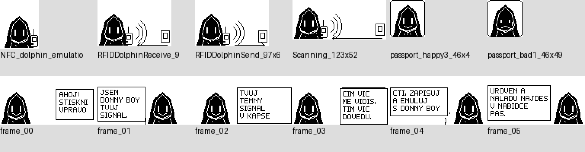

# DONNY BOY místo delfína

Grafika používá původní pixelovou kapuci DONNY BOY se svislýma očima.
Emulace a vysílání mají ruční vysílač, příjem opačný směr šipky.
Úspěch, uložení, smazání a varování mají vlastní symboly.

- NFC, LF RFID, Sub-GHz, iButton, infraport a sdílené dialogy.
- Devět portrétů pasu: tři nálady × tři úrovně. Náladu odlišují oči
  a ústa, úroveň počet značek na mikině.
- Obě animace zvýšení úrovně, úvodní průvodce, Bluetooth, U2F,
  DFU, reset PINu a odpojení USB.
- Původní animace plochy, blokující stavy a vestavěné záložní animace
  mají kapuci s mrkáním a pohybem. Vybrané scény používají počítač,
  knihu, hudební noty nebo vysílač. Původní autorské scény `DB_*`
  zůstávají zachované.
- Soukromé kopie obrázků v přibalených aplikacích HID, T5577,
  testu Sub-GHz a ukázce obrázků jsou upravené také.



## Zdroje a kontrola

`scripts/donny_mascot_assets.py` vytváří nativní jednobitové PNG pomocí
Pillow a existujícího kreslicího základu ze `scripts/donny_theme_assets.py`.
Spuštění z kořene repozitáře:

```sh
python scripts/donny_mascot_assets.py
```

Částečně upravované obrázky čte ze zdrojového commitu `4443f37e0`, aby
opakované spuštění nepoškodilo původní text. Tento commit musí být dostupný
v místní historii. Skript nespouští sestavení ani GitHub Actions.
Úplný seznam 1 036 bitmap je v `documentation/DonnyMascotAssets.json`.

Zůstávají původní názvy souborů a SDK symbolů, rozměry, manifesty,
pořadí snímků a časování. Služba `dolphin` dál spravuje původní zkušenosti
a náladu; uložený postup ani logika úrovní se nemění.

Ověřeny byly jednobitový formát, rozměry proti předchozím souborům,
existence snímků odkazovaných metadaty a náhled hlavních obrazovek.
Firmware nebyl sestaven ani otestován na fyzickém Flipperu.

Změny se projeví až po budoucím sestavení a instalaci firmwaru včetně
odpovídajících SD prostředků a přibalených FAP aplikací. Samostatné cizí
FAP soubory a vlastní animace již uložené na SD mohou mít vlastní grafiku;
jejich binární obsah tato úprava zdrojů nemění.
